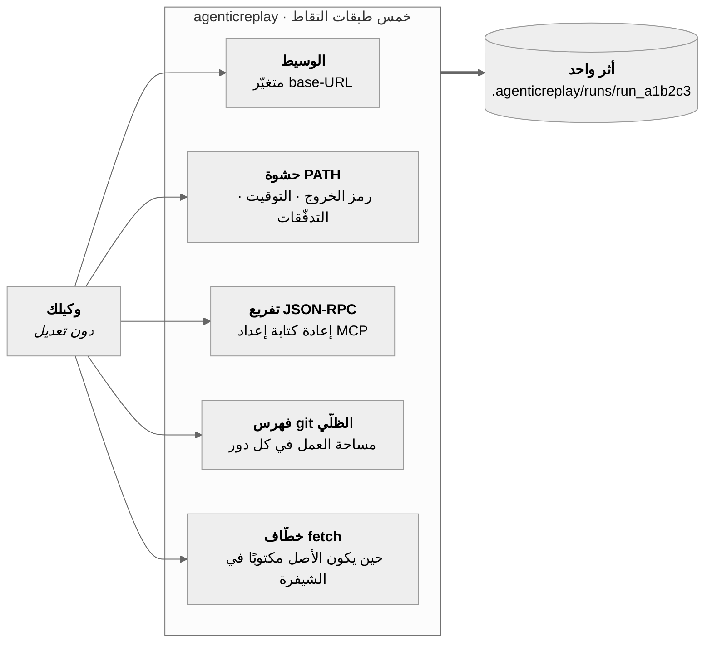
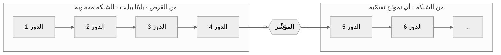

# AgenticReplay

<sub>[English](../../README.md) · [简体中文](README.zh-CN.md) · [日本語](README.ja.md) · [한국어](README.ko.md) · [Deutsch](README.de.md) · [Français](README.fr.md) · [Español](README.es.md) · **العربية**</sub>

<div dir="rtl">

### كسر وكيلك شيئًا في الثانية صباحًا. أعِد تشغيله في التاسعة — بالضبط، دون شبكة، وبقدر ما تشاء.

سجّل أي وكيل برمجي. أعِد إنتاج التشغيل بايتًا ببايت والشبكة مغلقة. تفرّع به من أي خطوة إلى نموذج
آخر وانظر من يصيب.

</a>

إلى Claude وGPT وGemini وGrok وDeepSeek وQwen وغيرها. هذا ما يشير إليه `agenticreplay setup` افتراضيًا، وهو
ما يجعل `agenticreplay compare` أمرًا واحدًا بدل أربعة حسابات لدى أربعة مزوّدين.


<br clear="right">

[](../../LICENSE)
[](../../spec/agenticreplay-trace-v0.md)
[](#التثبيت)
[](#التثبيت)
[](../good-first-issues.md)


<sup>مخرجات حقيقية من جلسة واحدة — تسجيل تشغيل لـ Claude Code، وإعادته والشبكة مغلقة، ثم تفريعه عند
نقطة التحقق 4 إلى نموذجين وتقييمه بـ `npx tsc --noEmit`. لا شيء هنا مُمثَّل.</sup>

## جرّبه بثلاثة أوامر

حزمة npm `agenticreplay` تضع الأمر `agenticreplay` في مسار PATH لديك، ولا تثبّت شيئًا داخل وكيلك.

```console
npm i -g agenticreplay             # the package is agenticreplay; the command is agenticreplay

agenticreplay record claude              # وكيلك، دون تعديل، يفعل ما يفعله
agenticreplay replay last                # التشغيل نفسه مرة أخرى — بلا شبكة، بلا رموز، بلا تكلفة
agenticreplay replay last --from 4 --model claude-haiku-4-5 --ui
```

السطر الثالث هو ما يجعل الناس يبقون: الملفات نفسها، وبادئة المحادثة نفسها، ونموذج مختلف ابتداءً من
الخطوة 4. النموذج هو المتغيّر الوحيد، وهذا ما يجعل للإجابة معنى.

## حدود القبول

يشمل التسجيل حركة API المدعومة. تُخزَّن الأجسام حتى 64 MiB افتراضيًا؛ وتبقى الاستجابة المقطوعة غير مكتملة ولا يمكن إعادة تشغيلها. راجع حالة اختبار العملاء والحدود في [`docs/agenticreplay-acceptance.md`](../agenticreplay-acceptance.md).

## لماذا وُجد هذا

تصحيح أخطاء الوكلاء اليوم أشبه بالتنقيب الأثري. تتصفح الطرفية إلى الأعلى، وتعيد التشغيل فتحصل على
عطل مختلف، وتضيف عبارات طباعة داخل مِهاد شخص آخر. الأدوات الموجودة هي أدوات رصد: تخبرك أن التشغيل
كلّف ‎4.12 دولار واستهلك 61 ألف رمز، وهذا ليس سؤالك. سؤالك هو: *لماذا حذف ملف الترحيل الخاص بي؟*

يجيب AgenticReplay عن ذلك بأن يعيد إليك التشغيل نفسه.

|  | أدوات الرصد | AgenticReplay |
|---|---|---|
| تخبرك بتكلفة التشغيل | ✅ | ✅ |
| تخبرك أي استدعاء أداة حذف الملف | أحيانًا | ✅ |
| تعيد تشغيل الوكيل فتصل إلى الإجابة نفسها | ❌ | ✅ دون شبكة، بايتًا ببايت |
| تتيح تغيير النموذج وإعادة التشغيل من الخطوة 4 | ❌ | ✅ |
| تحتاج إلى تعديل وكيلك | غالبًا غلاف SDK | ❌ متغيّرا بيئة اثنان |
| تعمل بعد إغلاق الطرفية | ❌ | ✅ لأنها ملف |
| ترى ما وراء واجهة النموذج — رموز خروج الصدفة وكتابة الملفات | ❌ | ✅ في كل دور |
| تسجّل وكيلًا لا نقطة نهاية له يمكن إعادة توجيهها | ❌ | ✅ باختيارك عبر `--tls-intercept` |

السطران الأخيران هما ما لا يستطيع غلاف SDK بلوغه بحكم بنيته. فالالتقاط يحدث *تحت* الوكيل — عند حدّ
العمليات والمقابس — ولذلك لا يهمّ أكان الوكيل لك، ولا أبإمكانك تعديله، ولا حتى أيملك مفتاح واجهة أصلًا:
فـ Codex CLI الموقّع باشتراك ChatGPT يتحدث إلى خادمه الخاص عبر TLS ولا يملك أي base URL يُوجَّه إلى مكان
آخر، ومع ذلك يستطيع agenticreplay تسجيله. انظر
[حين يرفض المِهاد أن يُعاد توجيهه](#حين-يرفض-المِهاد-أن-يُعاد-توجيهه).

## كيف يعمل

واجهات النماذج عديمة الحالة، لذا يعيد الوكيل في كل دور إرسال المحادثة كاملة — بما فيها نتائج أدوات
الدور السابق. **وبالتالي فإن وسيطًا أمام النموذج يرى الحلقة كلها**: كل طلب، وكل استجابة متدفقة، وكل
استدعاء أداة أصدره النموذج، وكل نتيجة أداة أنتجها المِهاد. على هذه الخاصية وحدها بُنيت الأداة، وهي
سبب أن **AgenticReplay لا يعدّل وكيلك** — يشغّل وسيطًا محليًا، ويضبط متغيّري بيئة، ثم يبتعد عن الطريق.

وهناك ثلاث طبقات أخرى تلتقط ما لا يستطيع البروتوكول رؤيته: رمز الخروج، والمدة الحقيقية، ومن أي
تدفّق خرج البايت، وملف كُتب دون أن يُخبر أحدًا. وهناك خامسة لأولئك الوكلاء الذين لا يقرؤون أي متغيّر base-URL أصلًا — انظر «أي الوكلاء» أدناه.



تصل الطبقات الأربع إلى الخط الزمني نفسه، مرتّبةً بحسب وقت حدوثها فعلًا لا بحسب وقت قراءة agenticreplay لها.

### الإعادة الدقيقة والتفريع والمقارنة شيء واحد

ليست ثلاثة أنظمة فرعية، بل هي الوسيط نفسه ومعه **مؤشّر**: الموضع في التدفّق المسجَّل الذي يتوقّف عنده
عن الإجابة من القرص ويبدأ الإجابة من الشبكة.



| الأمر | موضع المؤشّر | ما تحصل عليه |
|---|---|---|
| `agenticreplay replay last` | في النهاية | التشغيل كله مرة أخرى، **والشبكة محجوبة** — بلا رموز، بلا تكلفة، بلا تباين |
| `agenticreplay replay last --from 4 --model X` | عند نقطة التحقق 4 | الأدوار حتى 4 متطابقة، ثم يتولّى نموذج آخر |
| `agenticreplay compare last --from 4 --models a,b` | عند نقطة التحقق 4، عدة مرات | جدول واحد، ومتغيّر واحد — النموذج |

**نقطة التحقق** ليست مسجَّلة، بل *مُشتقّة*: أي موضع تكون فيه بادئة المحادثة مكتملة وتكون مساحة العمل
قد صُوِّرت. لذلك ينطلق كل تفريع من حالة يمكن إثبات أنها وُجدت فعلًا.

## كيف تبدو مطاردة عِلّة حقيقية

كان على وكيلك أن يصلح اختبار مصادقة فاشلًا. خرج بالرمز 0 والاختبار لا يزال فاشلًا. ابدأ بما فعله
فعلًا:

```console
$ agenticreplay show last
run_6473f858b59e  generic-openai@0.1.0  14 events  exit 0

SEQ  KIND   WHAT                                            DETAIL
0    RUN    run started                                     generic-openai
1    SNAP   tree 919d32ba037537b43814c83779963b2cc3023db7   0 changed
2    MODEL  claude-opus-5                                   1 messages
3    MODEL  claude-opus-5                                   stop: tool_use · 100 in · 20 out
4    TOOL   edit_file                                       {"path":"auth.ts",…}
5    SNAP   tree c6af62b75c0c8b8938bd6087328b5148f3dcd534   1 changed
6    FILE   auth.ts                                         modified +1 −3
7    TOOL   edit_file                                       ok
8    MODEL  claude-opus-5                                   3 messages
9    MODEL  claude-opus-5                                   stop: end_turn · 101 in · 5 out
10   SNAP   tree c6af62b75c0c8b8938bd6087328b5148f3dcd534   0 changed
11   SHELL  ["sh","-c","node --check nonexistent-file.ts"]  /tmp/hunt
12   SHELL  shell result                                    exit 1 · 43ms
13   RUN    run ended                                       exit 0

info usage input=201 output=25 cost=$0.004890
```

ثلاث حقائق لم يكن نصّ النموذج نفسه ليخبرك بها، وأخفاها رمز خروج التشغيل: الملف تغيّر فعلًا (الحدث 6،
`+1 −3`)، والفحص الذي أجراه الوكيل **فشل** (الحدث 12، `exit 1`)، ومع ذلك أنهى عمله. خرج التشغيل
بالرمز 0 لأن *الوكيل* خرج بالرمز 0.

هذه الحقيقة الأخيرة تستحق أمرًا خاصًا بها. يعطيك `agenticreplay show` ترتيب ما حدث، ويعطيك `agenticreplay graph` ما
الذي أنتج ماذا:

```console
$ agenticreplay graph last
FROM              TO               KIND      WHY
3 model.response  4 tool.call      recorded  tool_use block in the response
4 tool.call       6 fs.change      inferred  changed path appears in tool input, same or previous turn
4 tool.call       7 tool.result    recorded  tool result answers its call
7 tool.result     8 model.request  recorded  tool_result block in the request

  1 inferred — derived from this trace, not recorded in it
```

نوعان من الحواف، والفرق بينهما مهم. الحافة **recorded** كُتبت وقت التشغيل نفسه، لأن كتلة
`tool_use` موجودة فعليًا داخل الاستجابة التي أصدرتها. أما الحافة **inferred** فقد استُنتجت الآن
بالقاعدة التي تسمّيها — لقطة نظام الملفات تُؤخذ مرة كل دور لا مرة كل استدعاء أداة، فنسب تغيّر ملف
إلى استدعاء *بعينه* تخمين جيد وليس حقيقة. الحواف المستنتجة لا تُكتب أبدًا في التتبّع، تمامًا كما
تُشتق نقاط التفتيش ولا تُسجَّل.

يرسم `agenticreplay export last --card bug.svg` تلك السلسلة صورةً تلصقها في مسألة، ويرسم `--graph-card`
التشغيل كله مع إبراز السلسلة.

يظهر SVG داخل مسألة على GitHub وبالكاد في أي مكان آخر مهم — لا تقبله X كملف مرفوع، ولا يعطيه
Slack ولا Discord معاينة — فسمِّ الملف `.png` لتحصل على صورة، أو `.gif` فتُبنى السلسلة قفزةً
قفزة. هذا المسار يحتاج متصفحًا، وagenticreplay لا تعتمد على واحد: يُبقي `docs/media/README.md` أدوات الرسم
خارج `package.json` كي لا يدفع أحدٌ يشغّل `npm ci` ثمن تنزيل Chromium. وإن غابت، تذكر agenticreplay السطر
الوحيد الذي يصلح ذلك؛ ويبلّغ `agenticreplay doctor` عنها على أي حال، و`.svg` لا يحتاج شيئًا أبدًا.

```console
agenticreplay export last --card bug.png       # the chain, ready to post
agenticreplay export last --card bug.gif       # the same chain, one hop per frame
npm i --no-save playwright-core pngjs gifenc   # only needed for the two above
```

والآن أعِد إنتاجه بقدر ما تشاء، ومجانًا:

```console
$ agenticreplay replay last
info replay.done reused=2/2 canonical_exact=2 divergences=0 unmatched=0 exit=0
```

بلا شبكة، بلا رموز، بلا تباين. ثم اسأل سؤالك الحقيقي — *هل كان نموذج آخر ليصيب؟*

```console
$ agenticreplay compare last --from 5 --models claude-opus-5,claude-haiku-4-5 --verify "npm test"
MODEL             VERDICT  TOKENS  COST       WALL  RUN
claude-opus-5     pass     201/25  $0.004890  0.3s  run_1457b35062ba
claude-haiku-4-5  pass     201/25  $0.000326  0.3s  run_b8ee08479fb6
```

كلاهما نجح. وأحدهما يكلّف **أقل بخمسة عشر ضعفًا**. الملفات نفسها، وبادئة المحادثة نفسها، ونقطة
التحقق نفسها — النموذج هو الشيء الوحيد الذي تغيّر، وهذا هو السبب الوحيد في أن لذلك الرقم معنى.

## الخط الزمني

يفتح `agenticreplay replay last --ui` (أو `agenticreplay ui`) التشغيل كملف HTML واحد قائم بذاته — لا خادم يظل يعمل،
ولا شبكة، ولا شيء تثبّته. رشّحه، أو تنقّل فيه خطوة خطوة، أو اضغط المسافة وشاهده يُعاد بالإيقاع الذي
جرى به فعلًا.


كل طبقة تصل إلى الخط الزمني نفسه، فتقرأ التشغيل قصةً واحدة لا أربعًا: أدوار النموذج وعدد رموزها، وكل
استدعاء أداة بمعطياته ونتيجته، وأوامر الصدفة برموز خروجها وتوقيتها، وتغيّرات نظام الملفات مع الشجرة
التي أنتجتها.

يكتب `agenticreplay export last -o bug.html` تلك الصفحة بالضبط في ملف واحد يمكنك إرفاقه بتذكرة. وهو لا يحمل
أي مرجع خارجي على الإطلاق — والتكامل المستمر يتحقّق من ذلك — فيُعرض من مجلد التنزيلات، وفي الطائرة،
وبعد خمس سنوات.

## المهمة نفسها، نموذج مختلف

يفرّع `agenticreplay compare` تشغيلًا مسجَّلًا واحدًا إلى عدة نماذج من نقطة التحقق نفسها، بالملفات نفسها وبادئة
المحادثة نفسها، ويقيّم كلًّا منها بأمر تختاره أنت. النموذج هو المتغيّر الوحيد، وهذا ما يجعل للإجابة
معنى.


```console
agenticreplay compare last --from 4 \
  --models claude-sonnet-5,claude-haiku-4-5 \
  --verify "npm test" \
  --share verdict.svg          # البطاقة أعلاه، جاهزة للصق في تذكرة
```

### توجيهه إلى عدة نماذج

مقارنة النماذج تعني الوصول إلى عدة مزوّدين، وفعل ذلك يدويًا يعني أن تعرف بوجود `--upstream-anthropic`
و`--upstream-openai`، وأن بوابة واحدة قد تخدم صيغتَي البروتوكول، وأين يوضع المفتاح. كل ذلك حقيقي،
ولا شيء منه قابل للاكتشاف، فكان هناك أمر يسأل بدلًا من ذلك:

```console
$ agenticreplay setup
API key (stored 0600; leave blank for none):

  6 models available:
    anthropic/claude-opus-5
    anthropic/claude-haiku-4-5
    openai/gpt-5.2
    ...

$ agenticreplay models
MODEL                      $/MTOK IN  $/MTOK OUT
anthropic/claude-opus-5    15         75
anthropic/claude-haiku-4-5 1          5
openai/gpt-5.2             1.25       10
some-local-model           —          —
```

لا يكتفي `agenticreplay setup` بكتابة الملف، بل يسأل البوابة عمّا تخدمه فعلًا، فيصير الرابط الخاطئ أو المفتاح
الميّت إجابةً الآن بدل أن يكون خطأ 401 في منتصف مقارنة. وهو يحفظ كذلك النماذج التي اخترتها، فلا يحتاج
`agenticreplay compare last --verify "npm test"` بعدها إلى قائمة نماذج ولا إلى أي رايات upstream. أما
`agenticreplay models` فيسعّر ما يعرفه ويضع شرطة لما لا يعرفه، لأن اختلاق رقم لنموذج مجهول هو بالضبط الطريق
الذي ينتهي بجدول مقارنة يذكر تكلفة لم تكن حقيقية قط.

فيصير لديك مصدر واحد ومفتاح واحد يخدمان Claude وGPT وGemini وGrok وDeepSeek وQwen وغيرها، وهو تمامًا
الشكل الذي يريده `agenticreplay compare`. ومعرّفات نماذجه مسبوقة باسم المزوّد
(`anthropic/claude-sonnet-4.6`، `openai/gpt-4o-mini`)، وagenticreplay يتعامل مع ذلك: البادئة تختار صيغة
البروتوكول ثم تُنزع قبل التسعير.

إنه *قيمة افتراضية* لا وجهة: اكتب فوقه، أو مرّر `--gateway <url>`، وسيعمل بالكفاءة نفسها أي شيء يتحدث
نقاط `‎/v1/models` والمحادثة المتوافقة مع OpenAI — بوابة مستضافة أخرى، أو شيء تشغّله بنفسك.

وهو أيضًا ليس افتراضيًا إلا لحركة **أنت** طلبت إرسالها إلى مكان ما. فمن دون بوابة مضبوطة، يمرّر
`agenticreplay record` نداءات وكيلك مباشرةً إلى المزوّد الذي كان يتحدث إليه أصلًا، وبمفتاح الوكيل نفسه. لا
يعيد agenticreplay توجيه تسجيل لم تضبطه أنت: فذلك يعني إرسال شفرتك المصدرية إلى طرف ثالث كأثر جانبي للضغط على
زر التسجيل.

بلا تفاعل: `agenticreplay setup --key <k>` يأخذ الافتراضي، و`agenticreplay setup --gateway <url> --key <k>` يسمّي غيره،
و`--key-env <VAR>` يقرأ المفتاح من البيئة بدل إبقاء بيانات اعتماد على القرص.

المفتاح لا يصل إلى أثرٍ أبدًا. فهو يُرفق بالطلب الصادر فقط، بينما يُبنى ما يُسجَّل من الطلب *الوارد*
بعد نزع المصادقة — فهو غير مرئي للتسجيل بحكم البنية، لا بحكم قاعدة على أحدهم أن يتذكّرها. ويُحجب
كليًّا إذا وجّهت رايةٌ تلك الحركة إلى مكان غير البوابة التي أصدرته.

## أي الوكلاء

أمران يحدّدان إمكانية تسجيل مِهاد: هل يمكن توجيهه إلى الوسيط، وهل يفهم agenticreplay الصيغة التي يتحدثها حين
تصل إليه.

| الوكيل | كيف يُلتقط | الحالة |
|---|---|---|
| **Claude Code** | `ANTHROPIC_BASE_URL` | تعمل — تحقّقنا منها على إصلاح خلل حقيقي، [بالتفصيل](../validation.md) |
| **Codex CLI** (مفتاح API) | `OPENAI_BASE_URL` ← واجهة Responses | تعمل |
| **Codex CLI** (دخول ChatGPT) | `--tls-intercept` ← واجهة Responses | تعمل، مع قرار عليك أنت أن تتخذه |
| **OpenAI Agents SDK** | `OPENAI_BASE_URL` ← واجهة Responses | تعمل |
| **Vercel AI SDK** | خطّاف fetch — `agenticreplay record node -- node app.mjs` | تعمل |
| **LangGraph / LangChain** | `OPENAI_BASE_URL` و`ANTHROPIC_BASE_URL` | يُفترض أن تعمل — تمرّ عبر العملاء الرسميين، لكن لا شيء هنا يختبرها بعد |
| **grok-cli** (وبوت تيليغرام الخاص به) | `agenticreplay record grok` — `GROK_BASE_URL`، ومعه الخطّاف لوكلائه الفرعيين | تعمل |
| **OpenClaw** | `agenticreplay record openclaw` — الخطّاف للبوابة، والمتغيّرات الموروثة للوكلاء الذين تُطلقهم | تعمل |
| **opencode** | `agenticreplay record opencode` | المحوّل موجود، والأصلان معًا يُعاد توجيههما |
| **Hermes** (Nous Research) | `AGENTICREPLAY_BASE_URL_VARS=… agenticreplay record generic-openai -- hermes …` | يُفترض أن تعمل — يتجاوز الإعداد لكل مزوّد، انظر أدناه |
| **أي شيء آخر** | `agenticreplay record generic-openai -- <cmd>` | تعمل إن كان يقرأ متغيّر base-URL؛ وإلا فـ`agenticreplay record node -- <cmd>` |

Claude Code وحده هو ما شُغِّل من طرف إلى طرف على المِهاد الحقيقي. أما البقية فيصونها عقد المحوّلات
وملفات التثبيت التي تسجّل بالضبط أي المتغيّرات يضبطها كل محوّل، فإن غيّر مِهادٌ اسم المتغيّر الذي يقرؤه
احمرّ فحصٌ بدل أن يخرج تسجيل فارغ.

اثنان من هؤلاء احتاجا أكثر من متغيّر بيئة، والفرق جدير بأن تعرفه قبل اختيار الأمر.

**مِهاد يتحدث واجهة Responses.** يعتمد كل من OpenAI Agents SDK وCodex CLI افتراضيًا على
`/v1/responses` لا على chat completions. وagenticreplay يتحدثها، فلا حاجة إلى شيء خاص — لكن على إصدار أقدم لم
يكن العَرَض تسجيلًا ناقصًا، بل `404` في أول دور للوكيل.

**مِهاد لا يقرأ أي متغيّر base-URL.** لا يقبل `@ai-sdk/openai` الأصل إلا وسيطًا في الباني، فالوكيل
المبني على Vercel AI SDK يعمل تمامًا تحت `agenticreplay record`، ويخرج بالرمز 0، ويكتب تسجيلًا فارغًا. ومحوّل
`node` لهذا بالضبط: يكتب ملف تحميل مسبق صغيرًا في مجلد التشغيل، ويوجّه `NODE_OPTIONS` إليه، ويعيد
توجيه `globalThis.fetch` لقائمة مسموح بها من مضيفي المزوّدين لا غير.

```console
agenticreplay record node -- node agent.mjs
agenticreplay record node -- npm run agent
AGENTICREPLAY_INSTRUMENT_HOSTS='contoso.openai.azure.com' agenticreplay record node -- node agent.mjs
```

وهو محوّل مستقل لا سلوك افتراضي، لأن `NODE_OPTIONS` يصل إلى كل عملية Node يطلقها الوكيل — ثمن يستحق
الدفع حين تعرف أن وكيلك يحتاجه، لا أن يُفرض على من يسجّل مِهادًا بلغة Python.

يقبل Bun المتغيّر `NODE_OPTIONS` لكنه يتجاهل `--require` بداخله، ولذلك يُضبط `BUN_OPTIONS=--preload`
إلى جانبه فيُغطّى وكيل Bun أيضًا. وهذا مُتحقَّق منه على `bun` حقيقي، لأن الإخفاق الذي يمنعه هو الصامت:
ألا يعمل الخطّاف، فتذهب الحركة إلى المزوّد ولا يُسجَّل شيء.

**وإن عاد التسجيل فارغًا رغم ذلك**، يقول `agenticreplay record` ذلك بدل أن ينتهي بهدوء:

```console
warn capture.empty exchanges=0 cause="the agent never called the proxy — it may not read a base-URL variable" set=ANTHROPIC_BASE_URL,OPENAI_API_BASE,OPENAI_BASE_URL next="agenticreplay doctor"
```

**متغيّر base-URL لم يسمع به agenticreplay قط.** حصرها ميؤوس منه: ملف `.env.example` في Hermes وحده يحمل
`NOVITA_BASE_URL` و`GLM_BASE_URL` و`KIMI_BASE_URL` و`MINIMAX_BASE_URL` و`HF_BASE_URL`
و`NEBIUS_BASE_URL` وعشرة غيرها. وأي قائمة مثبّتة داخل agenticreplay ستصير قديمة بعد أسبوع، فسمِّ المتغيّر بنفسك:

```console
AGENTICREPLAY_BASE_URL_VARS='OPENROUTER_BASE_URL' agenticreplay record generic-openai -- hermes
AGENTICREPLAY_BASE_URL_VARS='GLM_BASE_URL,KIMI_BASE_URL' agenticreplay record generic-openai -- my-agent
```

كل اسم يُوجَّه إلى الوسيط مع إضافة `/v1`، وهو ما يريده أي تجاوز متوافق مع OpenAI؛ و`=<path>` يغيّر ذلك،
و`=/` يعطي الأصل مجرّدًا.

**بوابة تُطلق وكيل البرمجة.** لا تبرمج OpenClaw بنفسها: إنها تُطلق Claude Code أو Codex أو opencode
كعمليات فرعية. نداءات البوابة نفسها يلتقطها خطّاف fetch؛ أما نداءات وكيل البرمجة فتلتقطها المتغيّرات
المعتادة — لا لأن OpenClaw تقرؤها، بل لأن **العملية الابنة ترث بيئة أمّها**. وهذه خاصية نظام التشغيل لا
خاصية agenticreplay، ولذلك يحرسها اختبار.

## حين يرفض المِهاد أن يُعاد توجيهه

حقن base-URL يلتقط كل مِهاد يقرأ متغيّر base-URL، وخطّاف fetch يغطي وكلاء Node وBun الذين لا يقرؤون
أيًّا منها. أما Codex CLI الموقّع باشتراك ChatGPT فليس من هؤلاء ولا من أولئك: إنه يتحدث إلى خادمه الخاص
عبر TLS، فلا أصل يُعاد كتابته ولا `fetch` لنا يمكنه بلوغه. `--tls-intercept` هو
الجواب على ذلك، وقد جُعل عمدًا قرارًا منفصلًا عليك أن تتخذه، لأنه يُصدر سلطة تصديق.

```console
agenticreplay record codex --tls-intercept
agenticreplay record codex --tls-intercept --tls-hosts 'api.openai.com,*.chatgpt.com'
```

سلطة التصديق خاصة بذلك التشغيل وحده، ولا يثق بها إلا الوكيل الذي يشغّله agenticreplay — عبر بيئة تلك العملية
الابنة نفسها، لا عبر مخزن ثقة النظام أو المتصفّح أبدًا — وتُحذف عند انتهاء التشغيل. ولن يعرض agenticreplay
تثبيتها في أي مكان. أما المضيفون خارج قائمة السماح فيُنفَقون دون قراءة ويُسجَّلون كعنوان وعدد بايتات،
بلا مسار وبلا متن، لأن agenticreplay لم يملك النص الصريح قط. وطلب اعتراض كل شيء يُرفض ولا يُستجاب له.

وما يعود من ذلك ليس سطر سجلّ. فالطلب المعترَض تحلّله لهجات السلك نفسها التي تحلّل سواه، فيستقرّ في
الأثر بوصفه تبادلًا عاديًّا — يمكن إعادة تشغيله دون شبكة وتفريعه إلى نموذج آخر، في تشغيل لم يدخله
قطّ مفتاح من مفاتيحك.

وهو يعمل مع `agenticreplay replay --model` و`agenticreplay fork` و`agenticreplay compare` أيضًا، لأنها تشغّل وكيلًا حيًّا للسبب
نفسه.

## لوكيل أو سكربت أو CI

التسجيل ملف — وهذا وحده ما لا تستطيع لوحة المراقبة أن تكونه. لذا فأنفع سؤال عن تشغيل فاشل هو سؤال
يستطيع **وكيل** أن يطرحه: *أعِد تشغيل آخر جولة لي وقل لي أين حدث الانحراف.* كل أمر يجيب بالبيانات،
وagenticreplay يقدّم نفسه عبر MCP.

```console
$ agenticreplay replay last --json
{"runId":"run_a278eea7b535","mode":"exact","traceRunId":"run_687e3f84b208","matchedExact":2,"divergences":0,"unmatched":0,"liveCalls":0,"exitCode":0}

$ agenticreplay show last --json | jq '.events[] | select(.kind == "TOOL")'
$ agenticreplay checkpoints last --json | jq '.[-1].seq'
```

وثيقة JSON واحدة على stdout والتشخيص على stderr — ومعه مخرجات الوكيل المُسجَّل نفسه، فتبقى الوثيقة
قابلة للتحليل بينما التشغيل يتكلم. والإخفاقات تجيب بـJSON أيضًا مع رمز خروج غير صفري. ويغطي `--json`
الأوامر `list` و`show` و`events` و`checkpoints` و`graph` و`record` و`replay` و`compare` و`doctor`.

**أدواتٍ.** يقدّم `agenticreplay mcp` مخزن التسجيلات إلى وكيل عبر stdio:

```json
{ "mcpServers": { "agenticreplay": { "command": "agenticreplay", "args": ["mcp"] } } }
```

`agenticreplay_list_runs` و`agenticreplay_show_run` و`agenticreplay_checkpoints` و`agenticreplay_graph` و`agenticreplay_replay` و`agenticreplay_compare`. إعادة التشغيل
مجانية وبلا شبكة؛ أما `agenticreplay_compare` فيقول في وصفه هو أنه ينفق رموزًا حقيقية، لأن النموذج حين يختار
أداة لا يقرأ سوى ذلك النص.

**من الشيفرة**، إن كنت تفضّل ألا تمرّ بالصدفة:

```ts
import { AgenticReplay } from 'agenticreplay';

const agenticreplay = new AgenticReplay({ cwd: process.cwd() });
const { unmatched, divergences } = await agenticreplay.replay('last');
const timeline = await agenticreplay.show('last');
```

لا يكتب أبدًا على stdout الخاص بك ولا يستدعي `process.exit` — وكلاهما مصون باختبار، لأن المكتبة التي
تفعل أيًّا منهما لا يستطيع أحد أن يبني عليها.

## الحالة

مبكّرة. `v0` هو الهيكل السائر للأوامر الثلاثة أعلاه.

| القدرة | الحالة |
|---|---|
| صيغة الأثر v0 ومخطّط JSON | تعمل |
| التقاط نماذج Anthropic والمتوافقة مع OpenAI | تعمل |
| التقاط واجهة OpenAI Responses | تعمل — الصيغة التي يعتمدها OpenAI Agents SDK وCodex CLI افتراضيًا. تسجيل وإعادة تشغيل دون شبكة وتفريع؛ والتفريع يبقى على الصيغة التي يتحدثها الوكيل نفسه |
| وكلاء لا يقرؤون أي متغيّر base-URL | تعمل — `agenticreplay record node -- <cmd>` يكتب ملف تحميل مسبق في مجلد التشغيل ويعيد توجيه `globalThis.fetch` لقائمة مسموح بها من مضيفي المزوّدين فقط. Node وBun معًا، لأن Bun يتجاهل `--require` داخل `NODE_OPTIONS`. هكذا يُلتقط وكيل مبني على Vercel AI SDK |
| نداء لا يستطيع agenticreplay قراءته | تعمل — يُمرَّر بدل أن يُرفض، ويُسجَّل بوصفه `net.request` / `net.response`: دليل، لا دورًا قابلًا لإعادة التشغيل. والتسجيل الذي لم يلتقط شيئًا يُحذِّر بدل أن ينتهي بهدوء |
| مخرجات يقرؤها الحاسوب (`--json`) | تعمل — وثيقة JSON واحدة على stdout، والتشخيص على stderr، والإخفاقات أيضًا JSON |
| الرسم السببي (`agenticreplay graph`) | تعمل — ما الذي أنتج ماذا، كجدول أو كـ JSON. كل حافة تقول إن كان التتبّع قد سجّلها أم أن agenticreplay استنتجتها للتو، وتسمّي القاعدة في الحالتين. يضيّق `--to N` الأمر إلى السلسلة التي أنتجت حدثًا بعينه |
| بطاقات قابلة للمشاركة | تعمل — يرسم `agenticreplay export --card` سلسلة سببية واحدة، ويرسم `--graph-card` التشغيل كله مع إبراز تلك السلسلة، ويرسم `compare --share` جدول الأحكام. `.svg` دائمًا، و`.png` و`.gif` عند تثبيت أدوات الرسم الاختيارية التي يبلّغ عنها `agenticreplay doctor` ولا يجلبها `npm ci` أبدًا |
| خادم MCP (`agenticreplay mcp`) | تعمل — ست أدوات عبر stdio، ليتمكن وكيل من قراءة تشغيلاته وإعادة تشغيلها |
| واجهة برمجية (`AgenticReplay`) | تعمل — الأوامر تعرض ما تُرجعه، فالطرفية مجرد رؤية واحدة لحقيقة واحدة |
| إعادة دقيقة مع تقرير تباعد | تعمل — تستعيد نظام الملفات المسجَّل فوق شجرة عملك ثم تعيده كما كان؛ و`--worktree` لنسخة مؤقتة، و`--in-place` لعدم استعادة شيء. وتكتب تشغيلًا خاصًا بها يسجّل ما *اكتشفته* الإعادة — التباعدات والطلبات غير المطابَقة — وتشير إلى الأصل فيما كرّرته فحسب؛ و`--no-trace` لتخطّي ذلك |
| إعادة متفرّعة من نقطة تحقق | تعمل — التفريع يسجّل لقطات نظام ملفات خاصة به، فهو تشغيل يمكن تفريعه بدوره |
| لقطات نظام الملفات والفروق | تعمل |
| التصدير إلى ملف HTML واحد | تعمل |
| تسجيل نداءات MCP | تعمل — فعّلها بـ `--mcp-config <path>`. وتعيد الإعادةُ والتفريعُ التجهيزَ من الإعداد الذي استعمله التسجيل، فلا تتوقّف الطبقة عند نقطة التفريع |
| التنظيف اللاحق (`agenticreplay scrub`) | تعمل |
| التقاط الصدفة (حشوة `PATH`) | تعمل — رموز الخروج، والمدة، والفصل بين stdout وstderr. و`--no-shell` لتخطّيها |
| التقاط حركة الشبكة غير النموذجية | تعمل — فعّلها بـ `--tls-intercept`؛ تُصدر سلطة تصديق لكل تشغيل لا يثق بها إلا الوكيل المُشغَّل، وتفكّ تشفير قائمة مضيفين مسموحين، وتُنفق الباقي دون قراءة، وتحذف المفتاح عند الانتهاء |
| مُتحقَّق منه على وكيل حقيقي | Claude Code وهو يصلح علّة حقيقية فعلًا: سُجّل، وأُعيد دون شبكة من أوله إلى آخره، وفُرّع من نقطة تحقق، وصُدّر. انكسرت في الطريق أربعة أشياء لا يمكن لأي ملف تثبيت أن ينتجها، وأُصلحت كلها — [ما الذي وجده وكيل حقيقي](../validation.md) |
| المِهاد ذو المصادقة بالاشتراك | Claude Code يعمل. أما Codex CLI الموقّع باشتراك ChatGPT فيتحدث إلى خادمه الخاص ولا يقرأ متغيّر base-URL، فيحتاج `--tls-intercept` |

## التثبيت

```console
npm i -g agenticreplay
agenticreplay doctor
```

```console
git clone https://github.com/askdkc/AgenticReplay && cd AgenticReplay
npm ci && npm run build
npm install -g ./packages/cli     # يضع `agenticreplay` (و`agenticreplay`) في PATH
agenticreplay doctor                       # يفحص node وgit وأي وكلاء يستطيع إيجادهم
```

تنفيذ `npm install -g .` من جذر المستودع لا يثبّت شيئًا: الجذر مساحة عمل بلا ملف تنفيذي خاص، و`agenticreplay`
يقيم في `packages/cli`.

ما إن يُنشر `v0` حتى يصير `npx agenticreplay doctor` هو التثبيت كله، وسيقول هذا القسم ذلك عندئذ.
والإصدار سير عمل مبوَّب يُشغَّل بوسم — انظر [`RELEASING.md`](../../RELEASING.md).

**Node 24 فأعلى للتشغيل** (حقل `engines` في الـ CLI يقول `>=24.0.0`). أما المساهمة فتحتاج
`>=24.0.0` لأن سلسلة أدوات الاختبار تحتاجها؛ ويصرّح `package.json` في الجذر بذلك على
حدة، ليخبرك `npm ci` مقدّمًا. لا حساب، ولا تسجيل، ولا تغيير في مفاتيح الواجهات.

## أين تُحفظ تشغيلاتك

كل شيء يستقر في **`.agenticreplay/runs/` داخل المشروع الذي سجّلت فيه** — لكل مشروع على حدة، ولا مخزن عام
أبدًا، حتى يسافر الأثر مع النسخة التي ينتمي إليها. ودليل التشغيل الواحد شيء واحد يصف نفسه:

```
.agenticreplay/
  .gitignore          # مجرّد `*` — المخزن يستثني نفسه، فلا يمكن إيداع أثر بالخطأ
  runs/run_d0a2ee7ce615/
    manifest.json     # مَن، ومتى، وأي محوّل، وإيداع git، والأعداد، وبصمة السلامة
    events.jsonl      # الخط الزمني، كائن JSON في كل سطر، بالإلحاق فقط
    blobs/            # الحمولات التي تتجاوز 4 كيلوبايت، معنونة بالمحتوى ومنزوعة التكرار
    fs/               # فهرس git الظلّي: مساحة العمل في كل دور
    redactions.json   # ما أُزيل، بالقاعدة والعدد — لا بالقيمة أبدًا
```

للعثور على جلسة قديمة:

```console
agenticreplay list                       # كل تشغيل هنا، الأحدث أولًا، ومعه ما تفرّع عنه
agenticreplay show run_d0a2ee7ce615      # الخط الزمني في الطرفية
agenticreplay replay last                # `last` = أحدث تسجيل (يتخطّى آثار الإعادة)
agenticreplay replay run_d0a2ee7ce615    # أو سمِّ واحدًا صراحةً
agenticreplay gc --older-than 7d --dry-run   # ما الذي سيُستعاد، قبل أن يُستعاد شيء
```

يقرأ `agenticreplay list` أدلة التشغيل مباشرةً، فيعمل على أثرٍ أرسله إليك أحدهم: ضعه في `.agenticreplay/runs/` وستراه
كل الأوامر. لا فهرسة، ولا قاعدة بيانات يمكن أن تتلف.

## الخصوصية

الآثار محلية، بصلاحية `0600`، والمسجِّل لا ينشئ أي اتصال شبكي خاص به. وتُزال الأسرار في مسار الكتابة:
التقاط متغيّرات البيئة يقوم على المنع افتراضيًا، وترويسات المصادقة لا تُكتب أبدًا، وأشكال المفاتيح
المعروفة والسلاسل عالية العشوائية تُستبدل بعناصر نائبة ثابتة.

الإزالة تخفيف بأفضل جهد، لا ضمان. **عامِل الأثر على أنه حسّاس** — بقدر سجلّ الصدفة مضافًا إليه تفريغ
ذاكرة تقريبًا.

```console
agenticreplay export last -o bug.html          # يطبع بالضبط ما هو على وشك كتابته
agenticreplay scrub last --match my-hostname   # أزِل شيئًا بعد وقوعه
```

يعيد `agenticreplay scrub` كتابة `events.jsonl` والبيان وكل كتلة نصية، ويعيد تشغيل الكواشف القياسية، ويحدّث
بصمة السلامة، ويترك الكتل الثنائية متطابقة بايتًا ببايت.

لكنه لا يستطيع إعادة كتابة لقطات نظام الملفات. فكائنات git معنونة ببصمة محتواها نفسه، فتعديل واحدٍ
منها يغيّر معرّفه، وهو ما يفرض إعادة كتابة كل شجرة تسمّيه، ثم كل حدث يسمّي تلك الأشجار بعد ذلك — إعادة
كتابة للتاريخ نمط فشلها تشغيلٌ لم يعد يُستعاد. لذلك *يبحث* scrub في مخزن اللقطات ويخبرك إن كانت
سلسلتك ما تزال هناك، بدل أن يبلّغك بأثر نظيف لم يستطع تنظيفه. و`--drop-fs` يحذف المخزن كليًّا، بثمن
فقدان القدرة على تفريع ذلك التشغيل.

## ما هو مفتوح وما ليس كذلك

مفتوح دائمًا، برخصة Apache-2.0: صيغة الأثر، والنواة، وواجهة سطر الأوامر، والعارض، والمحوّلات، وواجهة
المزوّد.

يقترحه `agenticreplay setup` حين لا تسمّي بوابة. تلك قيمة افتراضية تراها ويمكنك الكتابة فوقها، في سؤال اخترت
أن تجيب عنه — لا مسار يسلكه شيء من تلقاء نفسه. وكل مسارات النماذج تبقى روابط عادية يمكنك توجيهها إلى
أي مكان، ولا يوجد مسار شفرة يعامل ذلك المصدر معاملة مختلفة عن أي مصدر آخر.

استعمال واجهة `Provider` العامة في `@agenticreplay/plugin-api`، وليس خلفها واجهة خاصة. ولا توجد بعد أي
إضافة من مزوّد، فمهمة التكامل المستمر التي تفرض ذلك (`scripts/check-neutrality.mjs`) تقول ذلك وتمرّ
بلا عمل؛ وستبدأ البناء مقابل الحزمة المنشورة بدل شفرة مساحة العمل لحظة ظهور أول إضافة. وإن احتاجت
إضافةٌ يومًا إلى قدرة، فتلك القدرة تدخل الواجهة العامة أولًا، ومعها تطبيق ثانٍ يثبت أنها ليست مفصّلة
على مقاس مزوّد بعينه.

## التوثيق

**ابدأ من هنا إن كانت لديك مشكلة الآن:**

- [كسر وكيلي شيئًا. كيف أعرف السبب؟](../how-to/debug-a-failing-agent-run.md)
- [لماذا حذف وكيلي ذلك الملف؟](../how-to/why-did-my-agent-delete-my-file.md)
- [هل كان نموذج آخر ليصيب؟](../how-to/compare-models-on-the-same-failure.md)

**المرجع:**

- [`spec/agenticreplay-trace-v0.md`](../../spec/agenticreplay-trace-v0.md) — صيغة الأثر المعيارية
- [`docs/architecture.md`](../architecture.md) — كيف يعمل الالتقاط والإعادة والتفريع فعلًا
- [`docs/validation.md`](../validation.md) — ما الذي انكسر أول مرة واجه فيها وكيلًا حقيقيًا
- [`docs/launch-path.md`](../launch-path.md) — ما أُنجز وما لم يُنجز وما هو التالي
- [`docs/plugins.md`](../plugins.md) — كتابة محوّل أو مزوّد
- [`CONTRIBUTING.md`](../../CONTRIBUTING.md) — حلقة تطوير من خمس دقائق
- [Good first issues](../good-first-issues.md) — اثنتا عشرة، ومع كل واحدة الملف الذي تبدأ منه

## المساعدة مطلوبة

الصيغة في v0 والهيكل السائر يعمل، وهذه هي اللحظة الممتعة في عمر أي مشروع: القرارات ما تزال رخيصة
التغيير، وثمة عمل واضح كثير كُتب معه الملف الذي يُبدأ منه.

- **[اثنتا عشرة good first issue](../good-first-issues.md)**، كل واحدة تسمّي الملف والاختبار.
- **اكتب محوّلًا.** ملف واحد، وتجهيزة واحدة. وإن كان مِهادك يقرأ متغيّر base-URL فهو نحو عشرين سطرًا —
  [docs/plugins.md](../plugins.md).
- **أعِد كتابة القارئ.** كون المواصفة برخصة CC BY 4.0 أمر مقصود. هناك قارئ بلغة Python بالفعل؛ وGo
  وRust ما زالتا شاغرتين.
- **اكسر الإعادة.** سلّم المطابقة هو قلب هذا كله، وأسرع طريق لتحسينه تسجيلٌ حقيقي يخطئ فيه. افتح
  تذكرة وأرفق بها `agenticreplay export last -o bug.html` — فهو ملف واحد قائم بذاته، و`agenticreplay scrub` موجود لأي
  شيء تريد إخراجه منه أولًا.

إن وفّر عليك بعد ظهيرة، فنجمة ⭐ تساعد غيرك على العثور عليه.

## الرخصة

Apache-2.0 للشفرة. ومواصفة الأثر برخصة CC BY 4.0، فيجوز لأي أحد إعادة تطبيقها.

</div>

---

<sub>
</sub>
